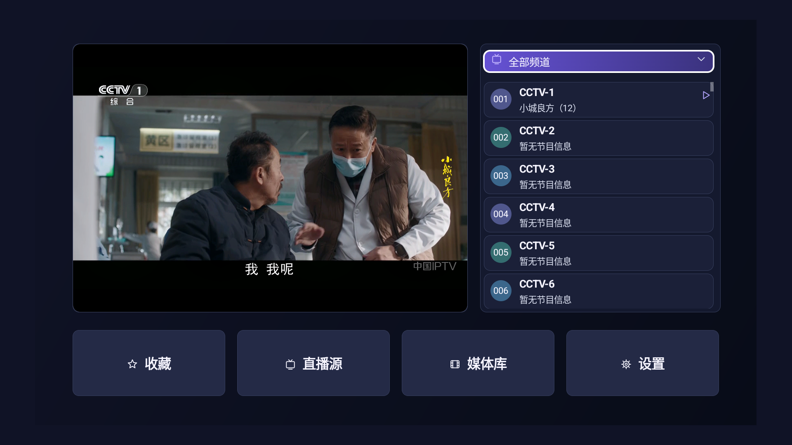
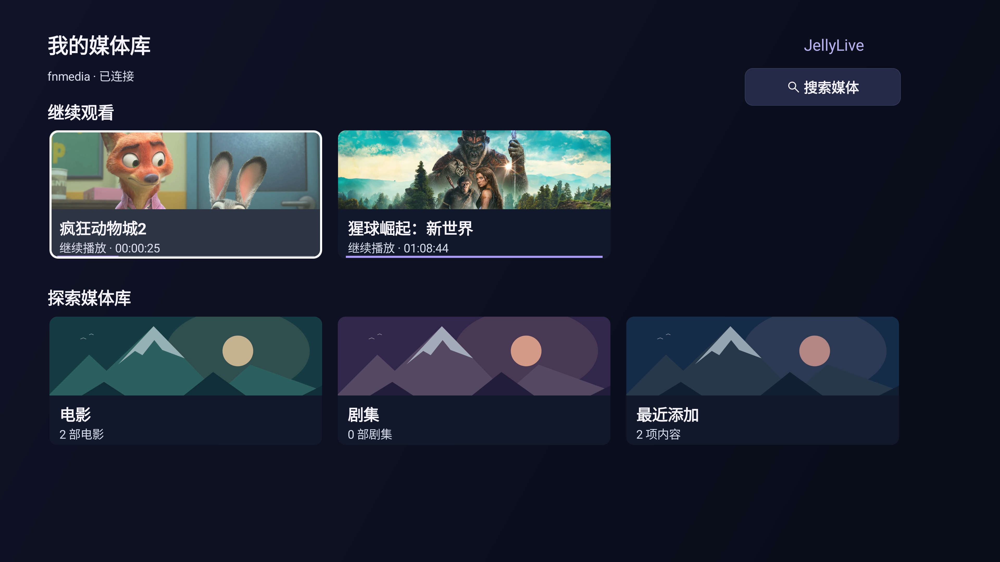
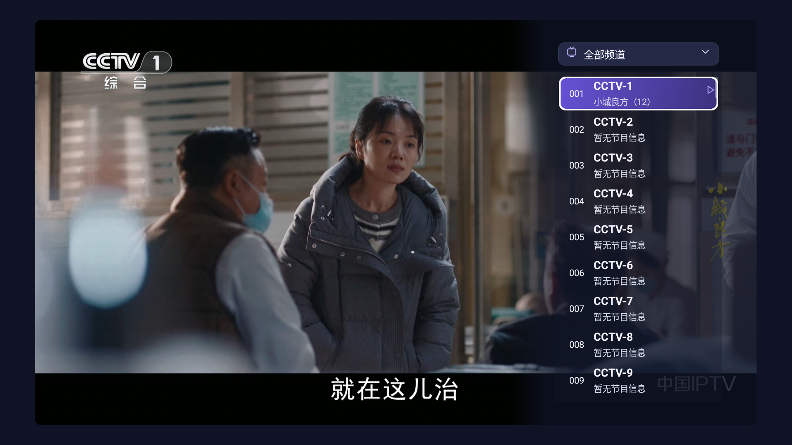
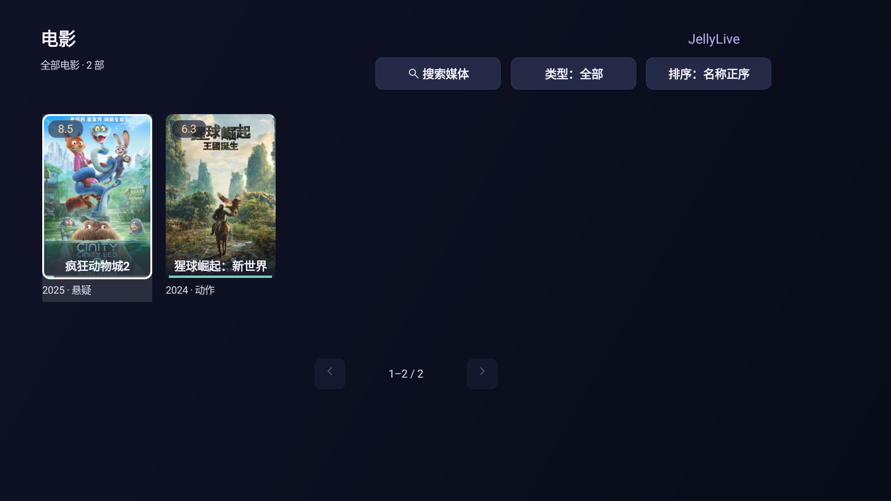
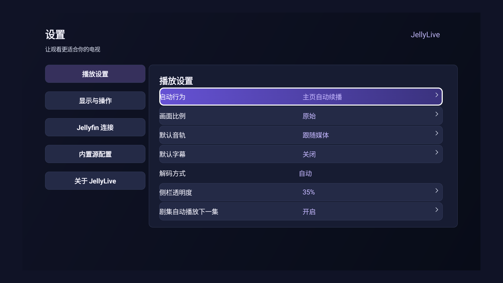
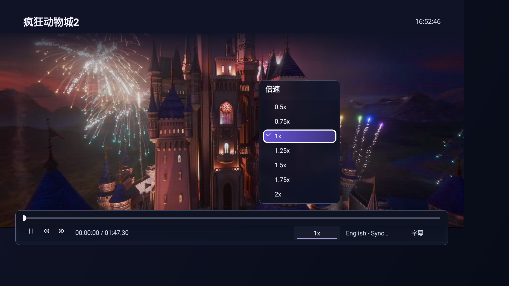

# JellyLive

面向 Android TV 的直播与媒体库客户端，适配遥控器操作，当前版本 **v0.1.3**。

基于 Jellyfin Android TV 0.19.10 修改，遵循 [GPL-2.0 许可证](LICENSE)。上游项目介绍见 [Jellyfin Android TV README](docs/upstream/README.md)。

## 界面预览

以下为应用实际运行截图。频道、海报及观看进度随连接的直播源和媒体库变化。

| 直播与设置 | 媒体库与播放 |
| :---: | :---: |
| **直播主页**<br> | **媒体库首页**<br> |
| **全屏频道侧栏**<br> | **电影列表**<br> |
| **播放设置**<br> | **媒体播放器**<br> |

## 功能

- **电视直播**：频道分组、收藏、节目单、预览与全屏播放；支持 M3U、自有机顶盒直播配置及 Jellyfin 直播频道。
- **遥控器操作**：方向键导航、确认键选择、返回键逐级返回；直播全屏长按确认可收藏或取消收藏。
- **媒体库**：连接和切换服务器，浏览电影、剧集和最近添加内容，查看详情与继续观看记录。
- **搜索与筛选**：直播和媒体分别搜索；媒体可按类型、观看状态、年份、分辨率、地区筛选，支持名称、评分、发布时间、时长等排序。
- **媒体播放**：续播、快进快退、触摸拖动进度、音轨与字幕选择、0.5x–2x 倍速（步进 0.25x），以及剧集自动播放下一集。
- **电视布局**：16:9 横屏、焦点高亮、电视安全区与大字号适配；频道侧栏和播放信息栏闲置自动收起。

“继续观看”展示尚未看完的媒体，保留本机播放进度，并在返回媒体库时刷新。

## 使用

使用前需准备直播源或媒体服务器：

1. 在“直播源”中添加 M3U 或 Jellyfin 来源；机顶盒直播可通过设置导入连接配置。
2. 进入“媒体库”，填写服务器地址、账号和密码。
3. 在设置中调整启动行为、画面比例、默认音轨、字幕及剧集自动播放偏好。

## 兼容性

媒体库使用 Jellyfin SDK，并对飞牛影视的目录、封面、详情及续播读取提供部分接口兼容。

视频格式支持取决于设备解码能力和服务器能力。当前飞牛兼容播放路径依赖设备直放，暂未提供重封装或转码兜底。

## 构建

需要 Docker 及包含 JDK 21、Android SDK / Build Tools 36.0.0 的构建镜像。默认镜像见 [构建脚本](scripts/build-container.sh)，可通过 `JELLYLIVE_BUILD_IMAGE` 指定其他镜像；运行前需准备对应镜像。

```sh
sh scripts/build-container.sh
```

默认缓存目录为 `.local-build/cache/`，可通过 `JELLYLIVE_GRADLE_CACHE` 指定其他位置。无内置连接配置的调试 APK 输出到 `dist/`。

应用默认在界面中配置连接。需要定制初始连接参数时，可参阅 [构建时配置](config/README.md)；已有会话及用户选择的服务器优先。

## 测试

完成构建并生成依赖缓存后运行：

```sh
sh scripts/check-container.sh
sh scripts/check-library-container.sh
```

检查覆盖直播交互、配置打包、版本规则、图片鉴权、媒体浏览与筛选、布局、播放状态、续播及自动下一集。
